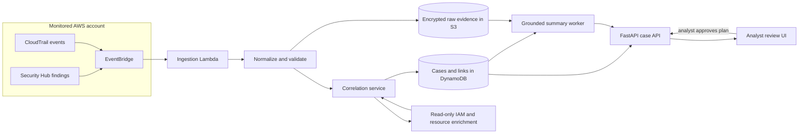

# SentinelGrid

**Development Status: In Progress**

Cloud security investigation and response planning. This repository currently contains design documentation only. The architecture and features below are proposed; no application implementation is claimed.

## Overview

An AWS security investigation platform that turns cloud findings into evidence-backed response plans.

## Problem

Cloud alerts arrive from several services with different formats and little context. Analysts spend time joining related events and can lose the evidence behind a response decision.

## Proposed solution

Normalize sample AWS security findings, correlate them with resource and identity context, and produce an analyst-reviewed investigation brief. A reasoning component may propose next steps, but it cannot change cloud resources.

## Proposed tech stack

Python, FastAPI, AWS EventBridge, Lambda, S3, DynamoDB, Security Hub, CloudTrail, IAM, Terraform; optional Amazon Bedrock for grounded summaries.

## Proposed architecture

The [architecture](architecture.md) explains the data flow and boundaries. The [technical design](technical-design.md) defines the first build and evaluation approach.

## Development roadmap

See the [phased development roadmap](development-roadmap.md). It describes planned work without implying that any phase is complete.
