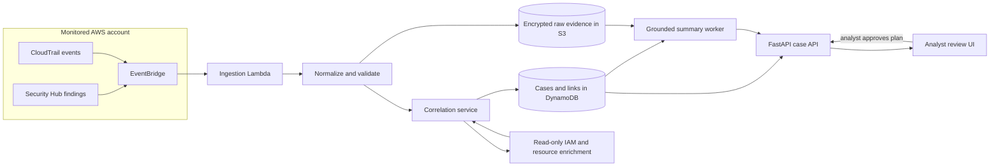

# SentinelGrid architecture

**Development Status: In Progress** — proposed design, not a deployed system.

## System diagram

## Data flow and boundaries

### Case model
Each case has a stable ID, linked finding IDs, affected resource ARNs, event timestamps, severity, evidence pointers, and a review state. Raw source events stay immutable in S3; DynamoDB holds only normalized fields and references.

### Processing contract
Ingestion validates schema and account allowlists, derives a deterministic deduplication key, then writes evidence before correlation. Correlation groups by resource, identity, and bounded time window. Failed processing goes to a dead-letter queue for replay.

### Human control
The summary worker cites exact evidence IDs and labels uncertainty. Its output is advisory. The first version has no remediation permissions; an analyst approves or rejects each proposed action in the UI.

## Security and operating boundaries

Use least-privilege read roles, KMS encryption, private evidence buckets, retention limits, redacted logs, and explicit separation between monitored and application accounts. Avoid importing real incident data into public demos.

## Initial deployment approach

Build the smallest local or low-cost proof of concept first. Introduce managed cloud services only after the data contracts and baseline evaluation work locally. Record configuration, dataset versions, and costs so results can be reproduced.
